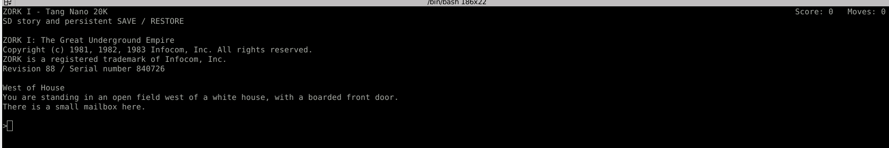

# Zork I on Tang Nano 20K

A dedicated Zork appliance for the Sipeed Tang Nano 20K (GW2AR-18C,
GW2AR-LV18QN88C8/I7). No operating system or external computer runs the game.
The FPGA contains a PicoRV32 processor and a bare-metal Z-machine V3 interpreter.
It runs the not supplied `zork1.dat`, release 88 / serial 840726.


## Clone this project

```bash
git clone https://github.com/dandydonh/tang-nano-20k-zork.git
cd tang-nano-20k-zork
```

See the build instructions below for required tools,
FPGA programming, and SD card preparation.

Zork I story data is not included.


The bitstream is **`impl/pnr/zork.fs`**. The matching SD image is
**`assets/zork-sd.img`**. Both are needed: the story is on SD, firmware is in
the bitstream. Persistent flash programming and verification succeeded;
the corrected serial header is confirmed on hardware in the screenshot below.
HDMI, PS/2 input, SD save/restore and power-cycle persistence still need
hardware validation.

The original project code is licensed under Apache 2.0; see [LICENSE](LICENSE).
Zork story data (`zork1.dat` and copies in SD images) is copyrighted third-party
material and is excluded from that license. Other third-party components retain
their own licenses; see [third_party/README.md](third_party/README.md).

## Play

<table>
  <tr>
    <td width="1676">
      <a href="zork_startup_screen.png">
        
      </a><br>
      <!-- Nonbreaking spacer keeps GitHub's table from shrinking the screenshot. -->
      <samp aria-hidden="true">&nbsp;&nbsp;&nbsp;&nbsp;&nbsp;&nbsp;&nbsp;&nbsp;&nbsp;&nbsp;&nbsp;&nbsp;&nbsp;&nbsp;&nbsp;&nbsp;&nbsp;&nbsp;&nbsp;&nbsp;&nbsp;&nbsp;&nbsp;&nbsp;&nbsp;&nbsp;&nbsp;&nbsp;&nbsp;&nbsp;&nbsp;&nbsp;&nbsp;&nbsp;&nbsp;&nbsp;&nbsp;&nbsp;&nbsp;&nbsp;&nbsp;&nbsp;&nbsp;&nbsp;&nbsp;&nbsp;&nbsp;&nbsp;&nbsp;&nbsp;&nbsp;&nbsp;&nbsp;&nbsp;&nbsp;&nbsp;&nbsp;&nbsp;&nbsp;&nbsp;&nbsp;&nbsp;&nbsp;&nbsp;&nbsp;&nbsp;&nbsp;&nbsp;&nbsp;&nbsp;&nbsp;&nbsp;&nbsp;&nbsp;&nbsp;&nbsp;&nbsp;&nbsp;&nbsp;&nbsp;&nbsp;&nbsp;&nbsp;&nbsp;&nbsp;&nbsp;&nbsp;&nbsp;&nbsp;&nbsp;&nbsp;&nbsp;&nbsp;&nbsp;&nbsp;&nbsp;&nbsp;&nbsp;&nbsp;&nbsp;&nbsp;&nbsp;&nbsp;&nbsp;&nbsp;&nbsp;&nbsp;&nbsp;&nbsp;&nbsp;&nbsp;&nbsp;&nbsp;&nbsp;&nbsp;&nbsp;&nbsp;&nbsp;&nbsp;&nbsp;&nbsp;&nbsp;&nbsp;&nbsp;&nbsp;&nbsp;&nbsp;&nbsp;&nbsp;&nbsp;&nbsp;&nbsp;&nbsp;&nbsp;&nbsp;&nbsp;&nbsp;&nbsp;&nbsp;&nbsp;&nbsp;&nbsp;&nbsp;&nbsp;&nbsp;&nbsp;&nbsp;&nbsp;&nbsp;&nbsp;&nbsp;&nbsp;&nbsp;&nbsp;&nbsp;&nbsp;&nbsp;&nbsp;&nbsp;&nbsp;&nbsp;&nbsp;&nbsp;&nbsp;&nbsp;&nbsp;&nbsp;&nbsp;&nbsp;&nbsp;&nbsp;&nbsp;&nbsp;&nbsp;&nbsp;&nbsp;&nbsp;&nbsp;&nbsp;&nbsp;&nbsp;&nbsp;&nbsp;&nbsp;&nbsp;&nbsp;&nbsp;&nbsp;&nbsp;&nbsp;&nbsp;&nbsp;&nbsp;&nbsp;&nbsp;&nbsp;&nbsp;&nbsp;&nbsp;&nbsp;&nbsp;&nbsp;&nbsp;&nbsp;&nbsp;&nbsp;&nbsp;&nbsp;&nbsp;&nbsp;&nbsp;&nbsp;&nbsp;&nbsp;&nbsp;&nbsp;&nbsp;&nbsp;&nbsp;&nbsp;&nbsp;&nbsp;&nbsp;&nbsp;</samp>
    </td>
  </tr>
</table>

[Open the full-size screenshot](zork_startup_screen.png). Scroll horizontally
above to see the full terminal at its original size.

Serial output from the Tang Nano 20K after the corrected firmware was flashed.
The fixed header shows `ZORK I - Tang Nano 20K` on the left and **Score** and
**Moves** at the terminal’s right edge; the game transcript scrolls below it.

1. Write `assets/zork-sd.img` as a **whole-card disk image** to a dedicated
   microSD card. This replaces the card's partition table and existing contents.
   Copying the image or `zork1.dat` into a normal FAT filesystem does not work.
2. Insert the card into the board's microSD slot. Leave it inserted during play.
3. Connect HDMI to a display accepting 1280x720 at 60 Hz.
4. Connect a keyboard using either method below, and program `impl/pnr/zork.fs`
   when ready. The existing `./program_flash.sh` uses device GW2AR-18C,
   cable 4, channel 0, flash operation 9.
5. Press the reset button on package pin 88 if necessary. The game opens at
   West of House. Enter commands such as `look`, `open mailbox`, `read leaflet`.

Type `save` to save, and `restore` to load the latest valid save. There is one
logical save slot with two alternating physical snapshots for recovery. Saves
persist on the SD card across reset and loss of board power. That persistence
has been simulated; physical power-cycle behavior still requires confirmation.
Save format is private to this firmware, not Frotz/Quetzal compatible.

### Standalone PS/2 keyboard

Use a PS/2 keyboard supporting scan code set 2, through a **3.3 V-safe PS/2
adapter**. A USB keyboard with a passive adapter only works if the keyboard
itself supports PS/2. A generic USB-only keyboard needs an external host adapter;
this core does not implement a USB host.

| Signal | FPGA package pin / header label |
| --- | --- |
| PS/2 clock, adapter's 3.3 V side | 25 |
| PS/2 data, adapter's 3.3 V side | 26 |
| Ground | GND |

PS/2 keyboards commonly use 5 V power and pull-ups. Do not connect 5 V signals
to the FPGA pins; use bidirectional open-drain level shifting and appropriate
pull-ups. Pins 25/26 refer to the board labels, not connector position numbers.
The receiver is input-only, so keyboard LEDs and host commands are not supported.
US layout letters, numbers, punctuation, Shift, Caps Lock, Enter and Backspace
are supported. Up recalls the last nonempty command; Down restores your draft.
Press Enter to submit a recalled command. History holds one command in RAM.
Cursor editing is not supported.

### Keyboard through USB serial

Connect the board's programming USB cable to a computer and open its onboard
serial port at **115200 baud, 8 data bits, no parity, 1 stop bit, no flow control**.
Serial Up/Down support ANSI CSI and SS3 sequences. Unsupported navigation
sequences are ignored; Backspace/Delete removes the last typed character.
Use a terminal with local echo disabled and CR or LF on Enter. Firmware emits
CRLF line endings. With the original LF-only build, Minicom Ctrl+A followed by
U enables "Add carriage return" to correct stair-stepped output. The onboard
BL616 bridge carries serial RX/TX on FPGA pins 70/69. HDMI and serial show the
same transcript. This uses the computer only as a keyboard/display terminal;
the FPGA runs the game. Close the terminal before programming if USB is busy.

At boot/reset, firmware sends ANSI sequences to reset text attributes, select
white text on the terminal's default background, clear the screen and move to
row 2 before the startup banner. The fixed first row shows
`ZORK I - Tang Nano 20K` on the left and score/moves at the right edge of the
terminal, with one blank column of margin. The project title appears only in
this header. Values refresh before each command while the transcript scrolls
below it. Use an ANSI/VT100 terminal at least 80 columns wide with
a black default background. Palette color 0 is deliberately avoided because
some themes render it gray even when the default background is black.
With Minicom inside Terminator, the default background can still resolve to
palette color 0. In Terminator's profile color preferences, set the first palette
color (black) to `#000000` if it is gray. The local default profile has been
corrected this way; its original config is backed up in
`impl/terminator-config.before-black`.

The UART receive FIFO is 16 bytes; type normally rather than pasting multiple
commands while the game is producing output. PS/2 and serial inputs can both
be connected. User serial output has been observed in Minicom; PS/2 hardware
and physical SD save/restore remain unverified.

## SD layout

The card uses a small dedicated **raw layout, not FAT**, avoiding dependence
on filesystem allocation during saves. The computer may offer to format it;
formatting would destroy the game and saves. Back up the first 1 MiB as an image
for a complete backup, including both saves.

| 512-byte sector | Content |
| --- | --- |
| 0 | `ZKSD` identifier, format version, story length, SHA-256 |
| 1–180 | Supplied 92,160-byte `zork1.dat` |
| 181–255 | Reserved |
| 256–319 | Save bank A: header, then VM snapshot |
| 320–383 | Save bank B: header, then VM snapshot |
| 384 onward | Unused |

The interpreter writes only sectors 256–383. Each snapshot includes dynamic
memory, evaluation stack, call frames, locals, PC and random generator state.
A 32-bit FNV-1a integrity hash is checked before restoring. The payload is written
before its commit header; a corrupted latest snapshot falls back to the previous
valid bank. SD card internal flash behavior can still affect power-loss recovery.

The SPI driver supports SD v1/v2 initialization and SDSC byte addressing or
SDHC/SDXC block addressing. Clock starts at 337.5 kHz, then rises to 3.375 MHz.
The firmware displays an error if the card does not initialize or its image is
missing. Reset after inserting a card; hot swapping is not supported.

To create another clean image without overwriting an existing backup:

```bash
python3 scripts/make_sd.py --output /tmp/zork-fresh.img
```

The generator refuses to replace existing files. Re-imaging the card removes
its saves. Do not write an image to a physical device until you have selected
and checked the intended removable card.

## Build and test

### Open in Gowin FPGA Designer

From this directory, run `./prepare_ide.sh`, then select **File > Open** in
Gowin FPGA Designer and open **zork.gprj**. The local IDE executable is
`/home/donh/IDE/bin/gw_ide`. The current checkout is already prepared.

The project selects **GW2AR-LV18QN88C8/I7**, device revision **C**, with
**zork_top** as the top module and **zork** as the output base name. It includes
all nine Verilog sources and the board pin/timing constraints. Memory images
and firmware sources appear under Other Files; they are excluded as synthesis
inputs, but the RTL loads the three memory images through `$readmemh`.

Run **Synthesize**, then **Place & Route** to generate `impl/pnr/zork.fs`.
The included `assets/firmware.hex` contains the current firmware, so an FPGA-only
IDE build does not require a RISC-V compiler. After editing C or assembly, run
`./scripts/build_firmware.sh` before rebuilding in the IDE. Gowin does not compile
the firmware sources automatically. Keep the `assets/` directory with the project.

Gowin keeps process settings in `impl/zork_process_config.json`.
`prepare_ide.sh` restores these from `ide/zork_process_config.json` when missing,
while preserving existing IDE settings. Build output and per-user `.gprj.user`
state remain generated files. Opening/building does not program the board.

### Command-line build and validation

```bash
./build.sh
bash tests/run.sh
bash -n build.sh scripts/build_firmware.sh tests/run.sh program_flash.sh
```

Tools: Gowin V1.9.11.03 Education at `/home/donh/IDE` (override `GOWIN_HOME`),
RISC-V GCC/binutils supporting `rv32im/ilp32`, Python 3, native GCC, Icarus Verilog
12 and Verilator 5 with G++/make. Current compiler/simulator installations were
extracted under `/tmp/zork-tools`; these are temporary and may need restoring.
Set `RISCV_PREFIX` to the RISC-V tool prefix, such as
`/opt/riscv/bin/riscv64-unknown-elf-`. `IVERILOG`, `VVP`, `VERILATOR`,
`VERILATOR_ROOT`, and `DFROTZ` can select alternative test tools.

The generated font and initialized RAM hex files are included. Font regeneration
uses Pillow and DejaVu Sans Mono: `python3 scripts/prepare_font.py`.
`./build.sh` compiles firmware, builds FPGA implementation and checks setup/hold
timing. It rejects stale bitstream output. SHA-256 hashes are in `impl/SHA256SUMS`.
The SD generator is separate so builds cannot overwrite saves or card images.

Tests cover native gameplay against Frotz, save/restore across processes,
corrupted snapshots, SD write boundaries, all SPI/UART byte values, PS/2
parity and timeout recovery, two full video frames and 100,000 TMDS symbols.
A compiled RTL integration test runs the real firmware through the processor,
SPI SDHC and SDSC card models, PS/2 and UART, then resets and restores from the retained card.

## Design and limits

- 27 MHz RV32IM CPU; 64 KiB on-chip initialized RAM. No SDRAM controller.
- 16 KiB static-story cache; 12 KiB dynamic memory allocation; 2,048-word Z stack;
  96 call frames. Linker reserves at least 8 KiB of native stack.
- HDMI carries DVI-compatible video, no audio. 80 columns by 32 rows, including
  a fixed inverse status row showing score and turns. Glyphs are 8x16 pixels,
  doubled horizontally; console occupies 1280x512 centered in 720p.
- Character wrapping, scrolling, basic line editing. No scrollback or MORE pause.
- Dedicated V3 implementation for this supplied game, not a general Z-machine
  conformance claim. No printer/transcript stream, split window or sound support.
  No complete 350-point playthrough has been validated.
- LED on pin 20 lights when HDMI PLL is locked and CPU has not trapped;
  that does not prove successful HDMI reception or game startup.

Sources and references:
[Z-machine standard](https://www.inform-fiction.org/zmachine/standards/z1point1/),
[PicoRV32](https://github.com/YosysHQ/picorv32),
[Sipeed board examples](https://github.com/sipeed/TangNano-20K-example),
[Sipeed board documentation and schematics](https://wiki.sipeed.com/hardware/en/tang/tang-nano-20k/nano-20k.html).
PicoRV32's ISC license is included in `third_party/PICORV32_COPYING`; the font
license is in `third_party/DEJAVU_COPYRIGHT`. HDMI/TMDS starts from the user's
adjacent `../hdmi_out` design. The supplied game file is retained unchanged.
