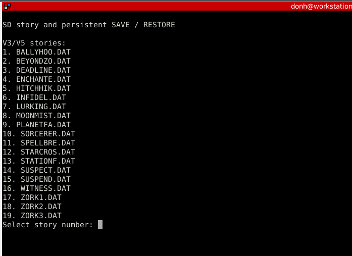
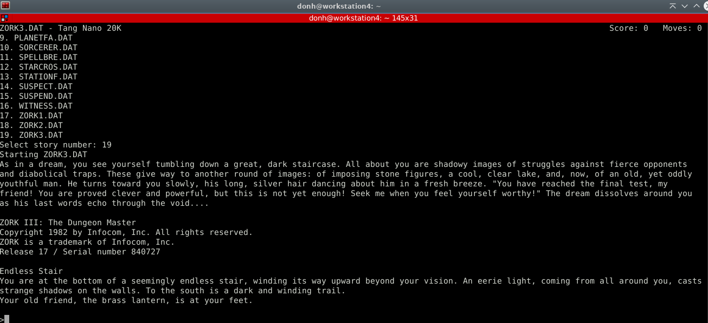

# Zork and V3/V5 stories on Tang Nano 20K

[Project website](https://dandydonh.github.io/tang-nano-20k-zork/) ·
[v0.5.0 preview downloads](https://github.com/dandydonh/tang-nano-20k-zork/releases/tag/v0.5.0)

A standalone Z-machine V3/V5 story player for the Sipeed Tang Nano 20K
(GW2AR-18C, GW2AR-LV18QN88C8/I7). A PicoRV32 processor runs the bare-metal
interpreter on the FPGA; no operating system or external computer runs the game.
Compatible `.dat` files can be copied onto a FAT16/FAT32 microSD card.
Story data is not included. The supplied local Zork I file is used for regression
validation; this is a bounded interpreter, not universal story compatibility.

The v0.5.0 prerelease supports V3 and V5 stories. Tested V5 editions include
Hitchhiker's Guide (release 31) and Beyond Zork (release 57); supply your own
story files. It also includes MORE paging and terminal-aware V3 serial output.
V5 games draw their own status, menus and split windows across a fixed
79-column by 32-row screen. Use a serial terminal at least 80 columns by 32 rows.
V3 keeps its header and adapts serial text to the detected terminal size.
See compatibility limits below.

## Clone this project

```bash
git clone https://github.com/dandydonh/tang-nano-20k-zork.git
cd tang-nano-20k-zork
```

See the build instructions below for required tools,
FPGA programming, and SD card preparation.

## Prebuilt v0.5.0 prerelease

Download the [v0.5.0 V3/V5 preview](https://github.com/dandydonh/tang-nano-20k-zork/releases/tag/v0.5.0):

- [zork.fs](https://github.com/dandydonh/tang-nano-20k-zork/releases/download/v0.5.0/zork.fs): FPGA bitstream for the Tang Nano 20K, GW2AR-18C.
- [SAVES.BIN](https://github.com/dandydonh/tang-nano-20k-zork/releases/download/v0.5.0/SAVES.BIN): blank **25 MiB** save pool, with five selectable positions for each of twenty story identities.
- [SHA256SUMS](https://github.com/dandydonh/tang-nano-20k-zork/releases/download/v0.5.0/SHA256SUMS): checksums for both files.

Download all three into the same directory and verify:

```bash
sha256sum -c SHA256SUMS
```

Place `zork.fs` at `impl/pnr/zork.fs` to use `./program_flash.sh`, after checking
its device, cable index and channel. Firmware is embedded in the bitstream;
stories load from a FAT16/FAT32 microSD card into integrated SDRAM at startup.
Adding a compatible V3 or V5 `.DAT` file to `/ZORK` requires file copying and
reset. Up to twenty stories are listed alphabetically for selection.

**The supplied SAVES.BIN is empty.** With the board off, copy it to
`/ZORK/SAVES.BIN` only when preparing fresh saves. Back up an existing pool and
use the [save expansion instructions](#one-time-save-preparation) to retain
wanted saves. Existing 2/5 MiB pools retain one position per story. V3 snapshots
remain compatible; V5 uses its own snapshot format within the same pool.
No story files or SD images are included in the release.

This build adds V5 support, MORE paging, independent serial/HDMI wrapping and
terminal-size checks before commands and after pauses. For serial resizing,
use [the Python launcher](#keyboard-through-usb-serial); Minicom 2.10 clears its
display when resized. V5 retains its fixed 79x32 layout and needs a terminal
at least 80 columns by 32 rows. The [previous v0.4.0 preview](https://github.com/dandydonh/tang-nano-20k-zork/releases/tag/v0.4.0)
remains available for V3 only. Tag `v0.5.0` identifies the source for this build.

Synthesis, place/route and timing checks pass. All eight broader processor
regressions pass, and the final firmware passes the actual-CPU resize fixture;
see [build and validation results](BUILD_RESULT.md) for the build distinction.
This exact bitstream passed persistent flash programming/readback. The supplied
screenshots show physical serial selection and Zork III output. Physical V5
play, launcher resize retention, HDMI/PS2, SD saves and power-cycle behavior for
this build still need observation.

The original project code is licensed under Apache 2.0; see [LICENSE](LICENSE).
Zork story data (`zork1.dat` and copies in SD images) is copyrighted third-party
material and is excluded from that license. Other third-party components retain
their own licenses; see [third_party/README.md](third_party/README.md).

## Play

With several stories on the card, startup shows a numbered selection menu:

[](story-selection-menu.png)

Selecting `19` starts Zork III. The serial display shows the selected story,
score and moves above the introduction, room description and command prompt:

<table>
  <tr>
    <td width="1306">
      <a href="bootup2.png">
        
      </a><br>
      <!-- Nonbreaking spacer keeps GitHub's table from shrinking the screenshot. -->
      <samp aria-hidden="true">&nbsp;&nbsp;&nbsp;&nbsp;&nbsp;&nbsp;&nbsp;&nbsp;&nbsp;&nbsp;&nbsp;&nbsp;&nbsp;&nbsp;&nbsp;&nbsp;&nbsp;&nbsp;&nbsp;&nbsp;&nbsp;&nbsp;&nbsp;&nbsp;&nbsp;&nbsp;&nbsp;&nbsp;&nbsp;&nbsp;&nbsp;&nbsp;&nbsp;&nbsp;&nbsp;&nbsp;&nbsp;&nbsp;&nbsp;&nbsp;&nbsp;&nbsp;&nbsp;&nbsp;&nbsp;&nbsp;&nbsp;&nbsp;&nbsp;&nbsp;&nbsp;&nbsp;&nbsp;&nbsp;&nbsp;&nbsp;&nbsp;&nbsp;&nbsp;&nbsp;&nbsp;&nbsp;&nbsp;&nbsp;&nbsp;&nbsp;&nbsp;&nbsp;&nbsp;&nbsp;&nbsp;&nbsp;&nbsp;&nbsp;&nbsp;&nbsp;&nbsp;&nbsp;&nbsp;&nbsp;&nbsp;&nbsp;&nbsp;&nbsp;&nbsp;&nbsp;&nbsp;&nbsp;&nbsp;&nbsp;&nbsp;&nbsp;&nbsp;&nbsp;&nbsp;&nbsp;&nbsp;&nbsp;&nbsp;&nbsp;&nbsp;&nbsp;&nbsp;&nbsp;&nbsp;&nbsp;&nbsp;&nbsp;&nbsp;&nbsp;&nbsp;&nbsp;&nbsp;&nbsp;&nbsp;&nbsp;&nbsp;&nbsp;&nbsp;&nbsp;&nbsp;&nbsp;&nbsp;&nbsp;&nbsp;&nbsp;&nbsp;&nbsp;&nbsp;&nbsp;&nbsp;&nbsp;&nbsp;&nbsp;&nbsp;&nbsp;&nbsp;&nbsp;&nbsp;&nbsp;&nbsp;&nbsp;&nbsp;&nbsp;&nbsp;&nbsp;&nbsp;&nbsp;&nbsp;&nbsp;&nbsp;&nbsp;&nbsp;&nbsp;&nbsp;&nbsp;&nbsp;&nbsp;</samp>
    </td>
  </tr>
</table>

Open the [story-selection menu](story-selection-menu.png) or [Zork III play example](bootup2.png)
at full size. Scroll horizontally above to view the play example at its original
size.

1. Prepare a FAT16/FAT32 card with a `ZORK` directory containing compatible
   `.DAT` stories and, for persistent saves, the preallocated `SAVES.BIN` described
   below. Existing unrelated files can remain on the card.
2. Insert the card into the board's microSD slot. Leave it inserted during play.
3. For HDMI output, connect a display accepting 1280x720 at 60 Hz. If using
   serial I/O, no HDMI connection or display is required.
4. Connect a keyboard using either method below and program the new
   `impl/pnr/zork.fs` when ready. The existing `./program_flash.sh` uses device
   GW2AR-18C, cable 4, channel 0, flash operation 9.
5. Reset the board. One compatible story starts automatically. If several are
   found, they are listed alphabetically by displayed filename. Enter a story
   number and press Enter. Reset to choose again.

Type the story's `save` or `restore` command. With a multi-slot pool, the
firmware lists numbered slots as **Saved** or **Empty**. Enter a slot number
and press Enter using serial or PS/2; Enter alone selects slot 1. Enter `0` or
`q` to cancel. Saving to an occupied slot asks `Overwrite slot N? [y/N]:`;
only `y` followed by Enter approves replacement. Declining returns to slot
selection. RESTORE rejects empty slots and lets you choose again or cancel.
Cancellation returns the story's normal save/restore failure response.

Each game has independent numbered positions. Every position retains two
alternating recovery banks; RESTORE loads its newest valid snapshot and falls
back to the older bank if necessary. **Saved** indicates a recognized snapshot
header; full payload validation happens during RESTORE. Existing 2/5 MiB pools
continue to work with one position and no slot prompt. Expand a backup as below
to enable multiple positions. Saves use a private format, not Frotz/Quetzal.
Earlier 512 KiB pools and v0.2.0 SAVEA/SAVEB snapshots cannot be imported.

### Standalone PS/2 keyboard

Use a PS/2 keyboard supporting scan code set 2, through a **3.3 V-safe PS/2
adapter**. A USB keyboard with a passive adapter only works if the keyboard
itself supports PS/2. A generic USB-only keyboard needs an external host adapter;
this core does not implement a USB host.

| Signal | FPGA package pin / header label |
| --- | --- |
| PS/2 clock, adapter's 3.3 V side | 25 |
| PS/2 data, adapter's 3.3 V side | 26 |
| Ground | GND |

PS/2 keyboards commonly use 5 V power and pull-ups. Do not connect 5 V signals
to the FPGA pins; use bidirectional open-drain level shifting and appropriate
pull-ups. Pins 25/26 refer to the board labels, not connector position numbers.
The receiver is input-only, so keyboard LEDs and host commands are not supported.
US layout letters, numbers, punctuation, Shift, Caps Lock, Enter and Backspace
are supported. Up recalls the last nonempty command; Down restores your draft.
Press Enter to submit a recalled command. History holds one command in RAM.
Cursor editing is not supported.

### Keyboard through USB serial

Connect the board's programming USB cable to a computer and open its onboard
serial port at **115200 baud, 8 data bits, no parity, 1 stop bit, no flow control**.
Serial Up/Down support ANSI CSI and SS3 sequences. Unsupported navigation
sequences are ignored; Backspace/Delete removes the last typed character.
Use a terminal with local echo disabled and CR or LF on Enter. Firmware emits
CRLF line endings. With the original LF-only build, Minicom Ctrl+A followed by
U enables "Add carriage return" to correct stair-stepped output. The onboard
BL616 bridge carries serial RX/TX on FPGA pins 70/69. HDMI and serial show the
same transcript. This uses the computer only as a keyboard/display terminal;
the FPGA runs the game. Close the terminal before programming if USB is busy.

For a terminal window you intend to resize, close Minicom and run the supplied
Python launcher from the project directory:

```sh
python3 scripts/serial_terminal.py /dev/ttyUSB1
```

It uses Python's standard library and sets 115200 baud, 8N1, with no flow
control or local echo. Press **Ctrl+]** or **Ctrl+A, then X** to disconnect.
This is a separate serial client from Minicom; both exit shortcuts work in
the launcher. Press Ctrl+A twice to send a literal Ctrl+A to the board.
Your desktop terminal
handles the display and scrollback; the launcher forwards the FPGA's ANSI size
queries and the terminal's replies unchanged. Resizing sends no screen clear.
Firmware applies the new dimensions at the next command or MORE pause.

Minicom 2.10 recreates and clears its display when its window is resized. This
was reproduced with a simulated serial port and no FPGA attached: resizing
sent a clear sequence to the desktop terminal, without any board traffic.
Use Minicom with a fixed window size, or use the launcher above when resizing.
The launcher restores console/serial settings and the full scrolling area on
exit. Enter `look` after connecting to show the current location again.

At boot/reset, firmware sends ANSI sequences to reset text attributes, select
white text on the terminal's default background, clear the screen and move to
row 2 before the startup banner. The fixed first row shows
`STORY.DAT - Tang Nano 20K` on the left and score/moves (or a V3 clock) at the
right edge of the terminal, with one blank column of margin. The project title appears only in
this header. Values refresh before each command while the transcript scrolls
below it. V3 story text wraps at word boundaries using the serial terminal's
reported width, leaving one column free. HDMI wraps independently at 79 columns.
Both outputs contain the same text with different line breaks. Explicit CRLF
line breaks keep serial output readable with terminal autowrap disabled.

Long output pauses at `[MORE]`. Press **Space** or **Enter** on the serial or
PS/2 keyboard to continue; that key is consumed by the pause. Firmware requests
an ANSI cursor report at startup, before each line command, and after each
pause. V3 paging uses the reported serial height, reserving the status row and
one prompt row; it is no longer capped at HDMI's 32 rows. HDMI can scroll
between serial page pauses. A 149x35 terminal uses 148 text columns and 33
completed lines per page. Resizing takes effect at the next command or pause;
already printed text is not reflowed. The probe preserves the input cursor,
typeahead and arrow keys, and filters delayed size replies from game input.
If the terminal does not reply, firmware retains its last detected size;
the startup fallback is 80 columns and 18 rows. V5 retains its fixed 79x32
window coordinates and requires an 80x32 or larger serial terminal.
Some stories reuse the counter labeled `Moves` for another purpose. Planetfall
release 37 uses it for Galactic Standard Time: it starts around 4500 and advances
by different amounts for different actions (`look` adds 9, `inventory` adds 18).
The game's `score` command reports the same clock value; it is not a count of
commands entered.
Overlong words split across lines without losing characters. Input echo is
immediate; Backspace and history replacement can erase across wrapped lines.
Use an ANSI/VT100 terminal at least 80 columns wide with
a black default background. Palette color 0 is deliberately avoided because
some themes render it gray even when the default background is black.
With Minicom inside Terminator, the default background can still resolve to
palette color 0. In Terminator's profile color preferences, set the first palette
color (black) to `#000000` if it is gray. The local default profile has been
corrected this way; its original config is backed up in
`impl/terminator-config.before-black`.

The UART receive FIFO is 16 bytes; type normally rather than pasting multiple
commands while the game is producing output. PS/2 and serial inputs can both
be connected. User serial output has been observed in Minicom; PS/2 hardware
remains unverified.

## SD files and preparation

Use **FAT16 or FAT32**, with 512-byte sectors. Unrelated files and VFAT long
filenames can share the card. exFAT is unsupported; back up existing contents
before any reformatting.

### Drop in a story

With the board powered off, copy a compatible `.dat` file into the card's
**`ZORK` folder**, safely eject the card, reinsert it and reset the board.
Every boot or board reset reads the directory again and builds the menu from
the files currently on the card. Game filenames and titles are not hardcoded;
adding, removing or replacing a compatible story requires no firmware rebuild.
No story conversion or per-story save-file preparation is needed. Up to 20
`.DAT` directory entries are discovered; incompatible headers are reported and
skipped. With multiple compatible files, enter a number (1–20) and press Enter at startup using serial
or PS/2. The menu sorts filenames alphabetically, independent of file-copy
order. The menu displays FAT short names (for example `MYSTOR~1.DAT` for a long
filename); simple names such as `ZORK2.DAT` are easiest to recognize.

Initial compatibility limits:

- Z-machine **V3** through **128 KiB**, and **V5** through **256 KiB**, with a
  minimum logical size of 64 bytes. The complete
  story loads into SDRAM, including fragmented files and partial final sectors.
- The full 16-bit writable-memory boundary is supported: up to **65,535 bytes**.
  Writes beyond the declared writable region remain forbidden.
- Padded files up to **1 MiB** are accepted when a nonzero header length declares
  a valid story within its version's size limit. Trailing bytes are ignored during execution,
  but their allocated sectors remain protected from saves. A zero-length header
  uses the actual file size, which must then fit the version's limit. No trimming is needed.
- Unsupported versions, sizes and memory layouts produce a clear startup message.
- 2,048-word evaluation stack and 96 call frames; unsupported operations fail
  with a core error. There is no claim that every V3 or V5 story will work.
- Score/moves and time-based V3 status are supported. V5 supports two windows (up to 31 upper rows),
  cursor positioning, inverse text, line/window erasure and one level of undo.
  Beyond Zork release 57 uses ASCII approximations for its IBM PC borders/arrows.
  Fonts 1 and 4 share the fixed text font; font 3, color, bold/italic, accented
  glyphs and timed input are not advertised. Unsupported glyphs render as `?`.
  Printer/transcripts, command files, sound and auxiliary-file save/restore
  are unavailable. Full-game playthroughs remain unverified.
- Output stream 1 can be enabled/disabled. Stream 3 captures raw ZSCII into
  dynamic memory, including newlines, with up to 16 nested tables; captured
  text bypasses the display and wrapping. Unsupported transcript/command-file
  selections report their unavailability; the transcript header bit stays clear.
  Existing ZMV5 saves load normally. Saves made with screen output disabled or
  memory capture active include a stream-state trailer and require this newer
  firmware to restore; ordinary saves retain the previous layout.

### One-time save preparation

Fresh preparation defaults to **five selectable saves per game** for up to
20 story identities, using one **25 MiB** preallocated file:

```text
ZORK/
  ZORK1.DAT     A compatible story, any supported size
  ZORK2.DAT     Another compatible story (optional)
  SAVES.BIN     Exactly 26214400 bytes by default; initially all zeros
```

For an existing card with a `ZORK` folder, this creates only a missing save pool:

```bash
python3 scripts/make_sd.py --directory /path/to/mounted/card --prepare-saves
```

Alternatively prepare the pool in an existing staging folder containing `ZORK`,
then copy just `SAVES.BIN` onto the card. The script refuses to overwrite it and
leaves existing stories and old save files untouched. Without a valid writable
pool, stories still play, but SAVE/RESTORE is disabled with an explanation.

**Preserve existing ZMV5 saves:** with the board powered off, copy the card's
`ZORK/SAVES.BIN` to your computer and keep that backup. Expand a copy:

```bash
python3 scripts/make_sd.py --expand-saves /path/to/backup/SAVES.BIN --output /tmp/SAVES.BIN
```

The default output is 25 MiB. All original bytes stay at their original offsets;
existing saves become player slot 1. Additional slots start empty. This accepts
old 2 MiB/eight-game pools, 5 MiB/twenty-game pools, and smaller multi-slot pools.
Existing outputs and shrinking/equal-capacity requests are refused. Copy the
expanded file to `ZORK/SAVES.BIN` with the board off, safely eject and reboot
with the new firmware. Keep the original backup for the old firmware, which
does not accept expanded pools.

Use `--save-slots N` for **1–20 positions per game** when preparing or expanding
pools. Each position adds 5 MiB: five positions use 25 MiB, ten use 50 MiB,
and twenty use 100 MiB. `--save-slots 1` prepares a single-position 5 MiB pool.
Legacy 512 KiB/SAVEA/SAVEB snapshots remain incompatible; preserve those files
separately before preparing a fresh pool. Never replace wanted saves with a
blank template.

To prepare a fresh staging directory with one or more stories:

```bash
mkdir -p /tmp/v3-card-files
python3 scripts/make_sd.py --directory /tmp/v3-card-files --story ./zork1.dat
# Repeat --story PATH to include additional stories during initial preparation.
```

Copy the resulting `ZORK` folder to the FAT card's root. Fresh preparation refuses
an existing `ZORK` folder so it cannot replace saved games. For a fresh disk image
instead, use `--output /tmp/v3-sdram-fat.img`; default is a 65 MiB disk image with a
64 MiB FAT32 partition. `--fat 16` selects a FAT16 volume sized for the requested files (normally
28 MiB with five slots); larger configurations should use FAT32. The option
`--superfloppy` omits the MBR. Image generation refuses existing output paths and
never writes a physical device. Writing an image to a card replaces its contents;
normal story-file copying preserves unrelated files.

### Saves and filesystem limits

The pool holds **20 story identities**, each with the configured number of
player-selectable positions. Each position has two 128 KiB snapshot banks.
Identity uses version, release, serial, checksum, logical story size and writable-memory size;
renaming a story or adding/removing trailing padding preserves its saves,
and different releases normally use
separate slots. Copies with the same identity share a slot. Removing a `.DAT`
file does not reclaim its saves. A full pool disables saves for new identities
while retaining access to existing ones. Back up the entire `SAVES.BIN` file
with the board powered off. No automatic slot deletion occurs.

Existing V3 `ZMV5` snapshots retain their format and remain usable. New V5 saves
use `ZMV6` snapshots with the V5 call, stream and window state. Both formats
share the existing pool layout and can coexist; the expansion tool preserves
both. The V3-only v0.4.0 firmware cannot restore V5 snapshots. These names refer
to this project's snapshot formats, not the version of the story file.

Firmware resolves file chains at startup and writes only the selected story's
currently selected position's save-pair data sectors. It never writes FAT tables, FSInfo or directory entries,
or creates/resizes files. Timestamps remain unchanged. Snapshot payload is
written before its commit header; each SD write waits for the card to finish
being busy. Hash verification and alternating banks allow fallback to an older
valid snapshot. Card-internal flash behavior still limits power-loss guarantees.
Conflicting or unrecognized slot ownership is preserved rather than reclaimed.

Supported layouts: a FAT volume without a partition table, or the first supported
FAT16/FAT32 primary partition in an MBR. FAT12, exFAT, GPT and extended/logical
partitions are unsupported. Cluster sizes of 1–128 sectors are accepted. Root and
game directories are each limited to 256 sectors (4,096 entries, including VFAT
records), and their allocations together to 32 coalesced sector extents.
File chains must match file sizes rounded to clusters. Use a healthy filesystem;
firmware does not run a whole-volume filesystem check.

The SPI driver supports SD v1/v2 initialization, SDSC byte addressing and
SDHC/SDXC block addressing. Clock starts at 337.5 kHz, then rises to 3.375 MHz.
Mappings are cached until reset: **do not hot swap the card or modify it from
another device while playing**. Power off before moving the card to a computer.

## Build and test

### Open in Gowin FPGA Designer

From this directory, run `./prepare_ide.sh`, then select **File > Open** in
Gowin FPGA Designer and open **zork.gprj**. The local IDE executable is
`/home/donh/IDE/bin/gw_ide`. The current checkout is already prepared.

The project selects **GW2AR-LV18QN88C8/I7**, device revision **C**, with
**zork_top** as the top module and **zork** as the output base name. It includes
all ten Verilog sources and the board pin/timing constraints. Memory images
and firmware sources appear under Other Files; they are excluded as synthesis
inputs, but the RTL loads the three memory images through `$readmemh`.

Run **Synthesize**, then **Place & Route** to generate `impl/pnr/zork.fs`.
The included `assets/firmware.hex` contains the current firmware, so an FPGA-only
IDE build does not require a RISC-V compiler. After editing C or assembly, run
`./scripts/build_firmware.sh` before rebuilding in the IDE. Gowin does not compile
the firmware sources automatically. Keep the `assets/` directory with the project.

Gowin keeps process settings in `impl/zork_process_config.json`.
`prepare_ide.sh` restores these from `ide/zork_process_config.json` when missing,
while preserving existing IDE settings. Build output and per-user `.gprj.user`
state remain generated files. Opening/building does not program the board.

### Command-line build and validation

```bash
./build.sh
bash tests/run.sh
bash -n build.sh scripts/build_firmware.sh tests/run.sh program_flash.sh
```

Tools: Gowin V1.9.11.03 Education at `/home/donh/IDE` (override `GOWIN_HOME`),
RISC-V GCC/binutils supporting `rv32im/ilp32`, Python 3, native GCC, Icarus Verilog
12 and Verilator 5 with G++/make. Filesystem tests also require `dosfstools`
(`mkfs.fat`, `fsck.fat`) and `mtools` (`mcopy`, `mmd`). Current compiler/simulator installations were
extracted under `/tmp/zork-tools`; these are temporary and may need restoring.
Set `RISCV_PREFIX` to the RISC-V tool prefix, such as
`/opt/riscv/bin/riscv64-unknown-elf-`. `IVERILOG`, `VVP`, `VERILATOR`,
`VERILATOR_ROOT`, and `DFROTZ` can select alternative test tools.

The generated font and initialized RAM hex files are included. Font regeneration
uses Pillow and DejaVu Sans Mono: `python3 scripts/prepare_font.py`.
`./build.sh` compiles firmware, builds FPGA implementation and checks setup/hold
timing. It rejects stale bitstream output. SHA-256 hashes are in `impl/SHA256SUMS`.
The SD generator is separate so builds cannot overwrite saves or card images.

Tests cover native gameplay against Frotz, save/restore across processes,
corrupted snapshots, interrupted saves at every sector boundary, FAT16/FAT32
with MBR/superfloppy layouts, fragmented files, VFAT coexistence, independent
mkfs.fat/mtools images, invalid media and unchanged metadata/unrelated files.
They also cover all SPI/UART byte values, PS/2
parity and timeout recovery, two full video frames and 100,000 TMDS symbols.
A compiled RTL integration test runs the real firmware through the processor,
SPI SDHC and SDSC card models with fragmented FAT16 files and an MBR FAT32
SDHC fixture, plus multi-story startup selection through UART and PS/2.
Each run resets and restores from the retained card. An additional processor
fixture exercises a padded 128 KiB story and a 65,535-byte writable region.
A command-level SDRAM model checks initialization, CAS latency, byte masks,
addressing and refresh deadlines. Original V3 programs exercise variable sizes,
high-memory reads, story identity and isolated saves. Optional private files in
`inspect_files/` are checked by `python3 tests/test_local_stories.py`; the directory
is ignored by Git and its contents are never included in the project.
Original V5 fixtures and optional `tests/test_v5_stories.py` cover high packed
addresses, objects above 255, nine-character dictionary entries, window output,
undo, and save/restore. `tests/test_v5.py` also checks mixed V3/V5 save ownership
and expansion; the supplied private V5 stories are not redistributed.

## Design and limits

- 27 MHz RV32IM CPU; 64 KiB initialized block RAM for firmware and native stack.
- 8 MiB integrated 32-bit SDR SDRAM, mapped at `0x30000000` with CPU wait states.
  A pristine story occupies the first 256 KiB; writable memory starts at
  `0x30040000`, and the V5 undo buffer at `0x30060000`.
  The controller uses CAS=2, single-word bursts, auto-precharge and
  autonomous refresh, including while waiting for input or SD transfers. Startup
  checks SDRAM data/address lines and byte enables before loading a story.
- 2,048-word Z stack and 96 call frames remain in block RAM. The linker reserves
  at least 8 KiB of native stack. No extra wiring or hardware is required.
- HDMI carries DVI-compatible video, no audio. 80 columns by 32 rows, including
  a fixed inverse status row for V3; V5 controls its own status/windows. Glyphs are 8x16 pixels,
  doubled horizontally; console occupies 1280x512 centered in 720p.
- Independent serial/79-column HDMI word wrapping, scrolling, `[MORE]` paging and basic line
  editing. No HDMI scrollback. One column remains free on an 80-column display.
- V3/V5 implementation with bounded memory, not a general Z-machine
  conformance claim. No printer/transcript stream or sound support.
  No complete 350-point playthrough has been validated.
- LED on pin 20 lights when HDMI PLL is locked and CPU has not trapped;
  that does not prove successful HDMI reception or game startup.

Sources and references:
[Z-machine standard](https://www.inform-fiction.org/zmachine/standards/z1point1/),
[PicoRV32](https://github.com/YosysHQ/picorv32),
[Microsoft FAT specification](https://www.scs.stanford.edu/~zyedidia/docs/_other/fat.pdf),
[Sipeed board examples](https://github.com/sipeed/TangNano-20K-example),
[Sipeed board documentation and schematics](https://wiki.sipeed.com/hardware/en/tang/tang-nano-20k/nano-20k.html).
PicoRV32's ISC license is included in `third_party/PICORV32_COPYING`; the font
license is in `third_party/DEJAVU_COPYRIGHT`. HDMI/TMDS starts from the user's
adjacent `../hdmi_out` design. The supplied game file is retained unchanged.
